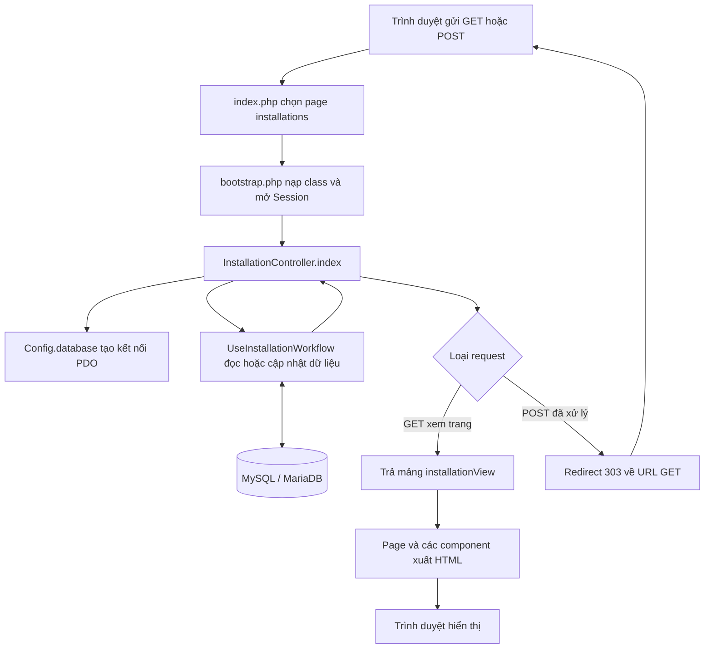
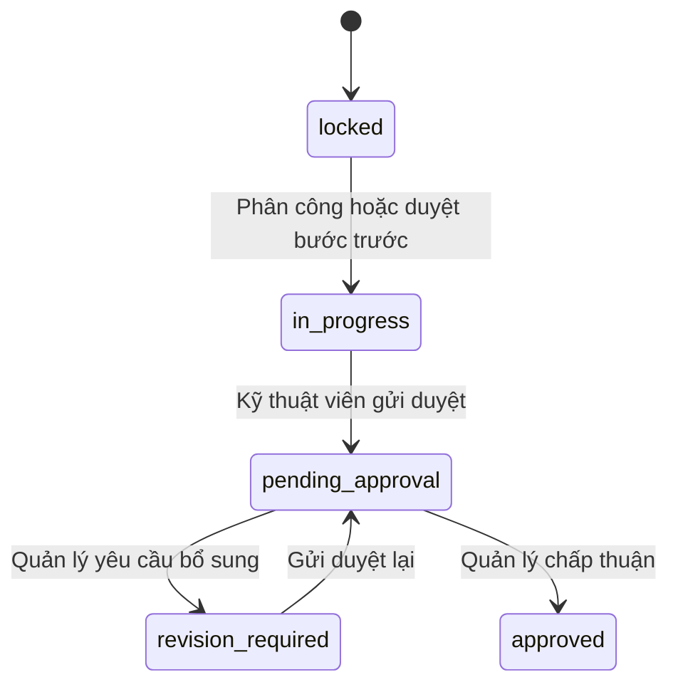

# TV4 — Các thay đổi, chức năng và luồng hoạt động của code

**Dự án:** SOLARIS — Quản lý lắp đặt điện mặt trời  
**Cập nhật:** 31/10/2026  
**Công nghệ:** PHP thuần 8.x, PDO, MySQL/MariaDB trên XAMPP, JavaScript và CSS  
**Mục đích:** Giúp thành viên đọc, chỉnh sửa và giải thích phân hệ TV4 khi trình bày đồ án.

Tài liệu mô tả mã nguồn hiện tại. Hướng dẫn import database, tài khoản mẫu và chạy kiểm thử nằm trong [TV4_INSTALLATION.md](TV4_INSTALLATION.md).

## Mục lục

1. [Phạm vi chức năng](#pham-vi)
2. [Các thay đổi đã thực hiện](#thay-doi)
3. [Vai trò các file](#cac-file)
4. [Luồng chạy tổng thể](#luong-tong-the)
5. [Luồng của từng chức năng](#luong-chuc-nang)
6. [Các hàm cốt lõi](#ham-cot-loi)
7. [Cơ chế kết nối và truy vấn database](#ket-noi-db)
8. [Database và các trạng thái](#database)
9. [Truyền dữ liệu sang view và component](#view-component)
10. [JavaScript và CSS](#giao-dien)
11. [Tích hợp với TV1 và TV3](#tich-hop)
12. [Kiểm tra và những giới hạn hiện tại](#kiem-tra)

<a id="pham-vi"></a>

## 1. Phạm vi chức năng

TV4 quản lý dự án sau khi báo giá được chấp thuận: phân công đội kỹ thuật, theo dõi sáu giai đoạn, lưu minh chứng, xử lý yêu cầu và ghi nhật ký.

| Chức năng | Quản lý `admin` | Kỹ thuật viên `technician` |
| --- | --- | --- |
| Xem dự án mới chờ phân công | Có | Không |
| Xem dự án đang thực hiện | Toàn bộ dự án phù hợp bộ lọc | Dự án được phân công còn hiệu lực |
| Chọn nhiều kỹ thuật viên cho dự án mới | Có | Không |
| Xem lịch, số dự án và % rảnh khi phân công | Có | Không có màn hình phân công; danh sách thay thế có số dự án và % rảnh |
| Xem thông tin, tiến độ và hồ sơ dự án | Có | Trong dự án được phân công |
| Upload minh chứng giai đoạn hiện tại | Không có thao tác upload trong luồng này | Có, khi giai đoạn đang làm hoặc cần bổ sung |
| Gửi duyệt giai đoạn | Không | Có |
| Duyệt hoặc yêu cầu bổ sung giai đoạn | Có | Không |
| Gửi yêu cầu hoãn lịch, đổi người | Không | Có |
| Duyệt hoặc từ chối yêu cầu | Có | Không |
| Xem lịch sử yêu cầu và nhật ký | Có | Trong dự án được phân công |

Khách hàng và khách vãng lai không sử dụng trang quản lý nội bộ này. Đăng ký tư vấn, tra cứu công khai và Bài 19–24 chưa nằm trong phạm vi triển khai này.

## 1.1. Sáu giai đoạn

| Thứ tự | Mã lưu trong database | Tên hiển thị |
| --- | --- | --- |
| 1 | `survey` | Khảo sát hiện trường |
| 2 | `design` | Lập thiết kế kỹ thuật & hồ sơ |
| 3 | `procurement` | Phê duyệt & mua sắm vật tư |
| 4 | `installation` | Thi công lắp đặt |
| 5 | `grid_connection` | Kiểm thử & Nối lưới EVN |
| 6 | `handover` | Bàn giao & nghiệm thu |

Quản lý phải duyệt bước trước thì bước tiếp theo mới mở. Tiến độ hiển thị được tính bằng số bước đã duyệt chia cho 6; gửi yêu cầu duyệt chưa được tính là hoàn thành.

<a id="thay-doi"></a>

## 2. Các thay đổi đã thực hiện

### 2.1. So với phần khung và thiết kế ban đầu

| Ban đầu | Hiện tại | Lý do |
| --- | --- | --- |
| Controller TV4 trả về thông tin chờ phát triển | Có đọc dữ liệu và xử lý form thực tế | Triển khai chức năng lắp đặt |
| Trang lắp đặt là placeholder trong `index.php` | Nạp page riêng, danh sách card và chi tiết dự án | Tách phần hiển thị của TV4 |
| Một cột `projects.technician_id` thể hiện người phụ trách | Nhóm kỹ thuật viên nằm trong `project_assignments` | Một dự án cần nhiều người |
| Chỉ có giai đoạn hiện tại và nhật ký | Thêm `project_stages` | Cần lịch và trạng thái duyệt riêng cho từng bước |
| Chưa có dữ liệu yêu cầu hoãn/đổi người | Thêm `project_requests` | Lưu lý do, đề xuất, người gửi và kết quả xử lý |
| Hồ sơ chỉ liên kết với dự án | Hồ sơ liên kết thêm `stage_id` | Kiểm tra minh chứng của đúng giai đoạn |
| Chưa có chỉ số mức rảnh | Tính số dự án đang làm và % rảnh theo lịch | Hỗ trợ quản lý chọn người |
| Chưa có điểm nối tạo dự án từ báo giá | Có `createFromApprovedQuote()` | TV3 có thể gọi sau khi chấp thuận báo giá |

### 2.2. Điều chỉnh cách viết để dễ đọc

- Thay bộ tự dịch Blade bằng `eval` bằng component PHP được nạp qua `require`.
- Tách hàm xử lý nhiều nhánh thành `switch` trong `act()` và các hàm nghiệp vụ riêng.
- Tách kiểm tra CSRF và đăng nhập khỏi phần chính của controller.
- Dùng tên biến rõ hơn như `$viewData`, `$project`, `$stage`, `$request`.
- Dùng vòng lặp thông thường ở những chỗ xử lý lựa chọn nhân viên và dữ liệu hiển thị.
- Định dạng lại HTML/CSS để dễ tìm và sửa từng phần.
- Bổ sung chú thích biến đầu vào của component; tự khai báo `$admin`, `$project` tại nơi sử dụng.
- Kiểm tra đầu vào của ba component; trả 404 khi chúng được mở trực tiếp mà không có dữ liệu từ nơi gọi.

Đợt chỉnh cách viết không thay đổi schema database. Các kiểm tra quyền, dữ liệu đầu vào, upload và transaction vẫn được giữ.

<a id="cac-file"></a>

## 3. Vai trò các file

Các đường dẫn trong bảng có thể nhấn để mở mã nguồn. File dùng PHP thuần dù page giữ đuôi `.blade.php` theo cấu trúc thư mục của nhóm.

| File | Vai trò |
| --- | --- |
| [index.php](../index.php) | Điểm vào ứng dụng; chọn trang và nạp bootstrap TV4 trước khi xuất HTML |
| [bootstrap.php](../app/Modules/Member4_Installation/bootstrap.php) | Khởi tạo Session, múi giờ, nạp class và gọi controller |
| [Config.php](../app/Modules/Member4_Installation/Config.php) | Đọc cấu hình và tạo kết nối PDO |
| [config.local.example.php](../app/Modules/Member4_Installation/config.local.example.php) | Mẫu cấu hình database riêng trên máy thành viên |
| [InstallationController.php](../app/Modules/Member4_Installation/InstallationController.php) | Nhận GET/POST, xử lý đăng nhập, điều phối nghiệp vụ, tải file và trả dữ liệu view |
| [UseInstallationWorkflow.php](../app/Hooks/UseInstallationWorkflow.php) | Chứa SQL, kiểm tra quyền dự án và quy tắc nghiệp vụ |
| [UseFileUpload.php](../app/Hooks/UseFileUpload.php) | Kiểm tra file, tạo hash và lưu file |
| [UsePaginationState.php](../app/Hooks/UsePaginationState.php) | Tính số trang, giới hạn và vị trí lấy dữ liệu |
| [View.php](../app/Modules/Member4_Installation/View.php) | Các hàm hỗ trợ xuất HTML, component, form, nhãn và phân trang |
| [installations.blade.php](../resources/views/pages/installations.blade.php) | Ghép giao diện đăng nhập, danh sách hoặc chi tiết |
| [detail.php](../resources/views/components/installation/detail.php) | Thông tin dự án, sáu bước, minh chứng, yêu cầu và nhật ký |
| [staff.php](../resources/views/components/installation/staff.php) | Bảng phân công: danh sách nhân viên 20%, lịch biểu 80% |
| [atomic.php](../resources/views/components/installation/atomic.php) | HTML của button, badge và input |
| [installation.css](../resources/css/installation.css) | CSS riêng TV4, sử dụng biến của theme chung |
| [installation.js](../resources/js/installation.js) | Giữ lựa chọn nhân viên khi chuyển trang, cập nhật số người đã chọn |
| [tv4-installation.sql](../database/tv4-installation.sql) | Cấu trúc database dành cho database mới |
| [tv4-demo.sql](../database/tv4-demo.sql) | Dữ liệu mẫu tùy chọn |
| [.htaccess](../assets/uploads/installation/.htaccess) | Chặn Apache phục vụ trực tiếp file trong thư mục upload |
| [tests/tv4-workflow.php](../tests/tv4-workflow.php) | Kiểm tra nghiệp vụ bằng database thử nghiệm riêng |
| [tests/tv4-http.php](../tests/tv4-http.php) | Kiểm tra đăng nhập, form, upload và quyền truy cập qua HTTP |
| [tools/export-tv4-demo.php](../tools/export-tv4-demo.php) | Tạo lại file SQL dữ liệu mẫu |

File cấu hình riêng `config.local.php`, file upload và file tạm được bỏ qua bởi `.gitignore`. Những file đó không phải mã nguồn cần chia sẻ với cả nhóm.

<a id="luong-tong-the"></a>

## 4. Luồng chạy tổng thể



### 4.1. Khi mở danh sách dự án

URL ví dụ:

```text
index.php?page=installations
```

1. `index.php` nhận `page=installations`.
2. `bootstrap.php` nạp các file cần dùng, mở Session nếu chưa có và đặt múi giờ Việt Nam.
3. Bootstrap gọi `(new InstallationController())->index()`.
4. Controller tạo `UseInstallationWorkflow` bằng kết nối trả về từ `Config::database()`.
5. Controller lấy ID người dùng từ Session và đọc lại vai trò từ bảng `users`.
6. Chưa đăng nhập: trả dữ liệu để page hiển thị form đăng nhập. Người có vai trò khác admin/technician: báo không có quyền dùng trang nội bộ.
7. Đã đăng nhập: gọi `listing()` để đọc danh sách theo quyền và bộ lọc.
8. Controller trả mảng `$installationView`; page gán sang `$viewData` và duyệt từng dự án để hiển thị card.

Admin mặc định vào bộ lọc `new`; kỹ thuật viên mặc định vào `in_progress`.

### 4.2. Khi mở chi tiết dự án

URL ví dụ:

```text
index.php?page=installations&project=2
```

Ngoài danh sách, controller gọi `detail()` cho dự án số 2. Hàm này kiểm tra quyền trước khi đọc giai đoạn, hồ sơ, nhóm kỹ thuật, các yêu cầu và nhật ký. Controller gọi thêm `availability()` để chuẩn bị thông tin nhân viên và lịch.

Page thấy có `$viewData['detail']` thì nạp `detail.php`. Nếu admin xem dự án `new`, file chi tiết nạp thêm `staff.php`.

### 4.3. Khi gửi form

1. Form gửi POST vào URL trang hiện tại. ID dự án nằm ở tham số GET `project`.
2. Controller kiểm tra CSRF; đọc người đăng nhập từ Session và database.
3. Các thao tác nghiệp vụ được chuyển tới `act()` cùng `action`, dữ liệu POST và file upload.
4. Hook kiểm tra quyền, điều kiện trạng thái và cập nhật database.
5. Thành công hoặc lỗi nghiệp vụ được ghi vào thông báo Session.
6. Controller gửi redirect HTTP 303 về URL GET của dự án.
7. Trình duyệt đọc lại dữ liệu và hiển thị kết quả.

Đây là cách POST → Redirect → GET: refresh trang sau khi lưu sẽ tải lại trang GET thay vì gửi lại form vừa xử lý. Đăng nhập và đăng xuất là hai thao tác controller xử lý riêng, không chuyển vào `act()`.

<a id="luong-chuc-nang"></a>

## 5. Luồng của từng chức năng

### 5.1. Bảng ánh xạ form và hàm xử lý

| Giá trị `action` | Người dùng | Hàm xử lý |
| --- | --- | --- |
| `login` | Người chưa đăng nhập | `InstallationController::login()` |
| `logout` | Người dùng đăng nhập bằng form riêng TV4 | Nhánh logout trong `InstallationController::index()` |
| `assign` | Admin | `assign()` |
| `upload` | Kỹ thuật viên trong nhóm | `uploadDocument()` |
| `submit_stage` | Kỹ thuật viên trong nhóm | `submitStage()` |
| `approve_stage`, `reject_stage` | Admin | `reviewStage()` |
| `postpone`, `replacement` | Kỹ thuật viên trong nhóm | `request()` |
| `approve_request`, `reject_request` | Admin | `reviewRequest()` |

Các hàm nghiệp vụ trong bảng nằm trong `UseInstallationWorkflow`. `act()` xác định giai đoạn hiện tại từ database; form không được tự chọn một giai đoạn tương lai để cập nhật.

### 5.2. Tạo dự án sau khi chấp thuận báo giá

```text
TV3 chấp thuận và lưu báo giá
    -> gọi createFromApprovedQuote(quoteId, adminId)
    -> kiểm tra báo giá approved và có user_id
    -> kiểm tra người thực hiện là admin
    -> nếu đã có dự án của báo giá thì trả lại ID cũ
    -> tạo projects với status mặc định new
    -> tạo đúng 6 dòng project_stages, ban đầu locked
    -> ghi nhật ký project_created
```

Đây là điểm tích hợp đã chuẩn bị; controller TV3 chưa được sửa để tự gọi hàm. Không chạy demo tính toán là tự động có dự án. Dự án phải được tạo từ báo giá đã chấp thuận qua điểm tích hợp này.

### 5.3. Phân công nhiều kỹ thuật viên

```text
Admin mở dự án mới
    -> xem lịch và mức rảnh
    -> chọn nhiều người, khoảng ngày và giờ/người/ngày
    -> gửi action=assign
    -> kiểm tra ngày, số người, vai trò và số giờ
    -> thêm các dòng project_assignments
    -> chia ngày làm việc cho 6 giai đoạn
    -> mở bước survey và đổi dự án sang in_progress
```

`projects.technician_id` lưu người đầu tiên trong nhóm để tương thích thiết kế trước. Quyền dự án của cả nhóm được kiểm tra bằng `project_assignments`, không chỉ bằng cột này.

### 5.4. Upload minh chứng

```text
Kỹ thuật viên chọn file tại giai đoạn đang làm
    -> gửi action=upload và file qua multipart/form-data
    -> kiểm tra quyền và trạng thái giai đoạn
    -> UseFileUpload::inspect() kiểm tra file
    -> kiểm tra nội dung đã có trong cùng giai đoạn chưa
    -> UseFileUpload::store() lưu file
    -> INSERT project_documents và ghi nhật ký
```

File được lưu trên ổ đĩa; database lưu đường dẫn và thông tin file, không lưu toàn bộ nội dung ảnh vào cột database. Nếu ghi database thất bại sau khi lưu file, code có xử lý xóa file vừa tạo. Transaction của MySQL không tự hoàn tác file trên ổ đĩa.

### 5.5. Gửi duyệt và duyệt giai đoạn

```text
Kỹ thuật viên gửi action=submit_stage
    -> kiểm tra giai đoạn đang làm hoặc cần bổ sung
    -> bắt buộc ít nhất 1 ảnh JPG/PNG của giai đoạn
    -> nếu đang xin hoãn thì kiểm tra ô xác nhận
    -> chuyển sang pending_approval

Admin gửi action=approve_stage
    -> kiểm tra giai đoạn đang chờ duyệt
    -> chuyển sang approved
    -> đóng các yêu cầu còn chờ của giai đoạn
    -> mở bước tiếp theo, hoặc hoàn tất dự án nếu là bước 6
```

Nếu admin gửi `reject_stage`, lý do là bắt buộc và trạng thái chuyển sang `revision_required`. Kỹ thuật viên có thể bổ sung tài liệu và gửi duyệt lại. Bước tiếp theo vẫn khóa.

### 5.6. Hoãn lịch và tiếp tục công việc

1. Kỹ thuật viên gửi lịch bắt đầu/kết thúc mới cùng lý do bằng `action=postpone`.
2. Hệ thống lưu yêu cầu `pending`; chưa thay đổi lịch chính thức.
3. Công việc có thể tiếp tục khi điều kiện thuận lợi.
4. Nếu gửi duyệt hoàn thành khi yêu cầu hoãn vẫn chờ, phải xác nhận `acknowledge_postpone=1`.
5. Khi giai đoạn được duyệt hoàn thành, yêu cầu hoãn còn chờ được đóng với trạng thái `superseded`.

Nếu admin chấp thuận hoãn trước khi gửi duyệt hoàn thành, lịch giai đoạn được thay đổi. Ngày kết thúc các bước sau, dự án và phân công nhóm được dời theo chênh lệch ngày kết thúc cũ/mới.

Ví dụ: ngày kết thúc giai đoạn đổi từ 10/11 sang 13/11 thì các bước sau dời thêm 3 ngày lịch. Cơ chế dời không tự bỏ cuối tuần.

Khi giai đoạn đang `pending_approval`, hệ thống chặn **chấp thuận** yêu cầu hoãn/đổi người. Admin cần duyệt hoàn thành hoặc trả giai đoạn về bổ sung trước khi chấp thuận yêu cầu đó; thao tác từ chối yêu cầu vẫn có thể thực hiện nếu yêu cầu còn hợp lệ.

### 5.7. Đổi người trong nhóm

```text
Kỹ thuật viên chọn người cần thay và người thay thế
    -> gửi action=replacement cùng lý do
    -> kiểm tra người cũ đang trong nhóm, người mới là technician và chưa trong nhóm
    -> lưu yêu cầu pending
    -> admin chấp thuận
    -> kiểm tra lại điều kiện để tránh dùng yêu cầu đã cũ
    -> kết thúc phân công cũ bằng ended_at
    -> thêm phân công mới
    -> cập nhật technician_id nếu người bị thay là người đầu tiên/trưởng nhóm
```

Không xóa dòng phân công cũ để giữ lịch sử. Người bị thay mất quyền truy cập khi không còn phân công hiệu lực; người mới nhận quyền qua dòng phân công mới.

<a id="ham-cot-loi"></a>

## 6. Giải thích các hàm cốt lõi

Trừ những hàm có ghi rõ class khác, các hàm sau nằm trong [UseInstallationWorkflow.php](../app/Hooks/UseInstallationWorkflow.php).

### 6.1. `listing($actor, $filter, $page)` — đọc danh sách project

**Đầu vào:** người đang thao tác, bộ lọc và số trang.

**Xử lý:**

1. Tạo `$where` và `$params` để ghép điều kiện truy vấn.
2. Nếu không phải admin, thêm điều kiện có phân công `ended_at IS NULL` cho người hiện tại.
3. Thêm trạng thái `new`, `in_progress`, `completed` nếu chọn bộ lọc tương ứng. Bộ lọc `pending` của admin kiểm tra dự án có yêu cầu hoặc giai đoạn chờ duyệt.
4. `SELECT COUNT(*)` lấy tổng số dự án và gọi `UsePaginationState::make()`.
5. `SELECT p.*` lấy thông tin dự án cùng số bước đã duyệt, số thành viên và số yêu cầu chờ.
6. Sắp xếp theo nhóm trạng thái, thời điểm tạo và ID; áp dụng `LIMIT`/`OFFSET`.

`$where = '1=1'` tạo điều kiện luôn đúng ban đầu, giúp thêm các điều kiện `AND ...` phía sau thuận tiện hơn. Các giá trị từ người dùng được truyền qua `$params`, không nối trực tiếp vào SQL.

**Đầu ra:**

```php
[
    'projects' => $projects,
    'pager' => $pager,
]
```

Controller gọi:

```php
$view['listing'] = $workflow->listing(
    $actor,
    $view['filter'],
    (int) ($_GET['p'] ?? 1)
);
```

Page hiển thị bằng:

```php
foreach ($viewData['listing']['projects'] as $project):
    // Xuất card của dự án.
endforeach;
```

Muốn sửa điều kiện đọc danh sách thì tìm `listing()`. Muốn sửa nội dung card thì tìm vòng `foreach` trong page.

### 6.2. `project($id, $actor, $lock = false)` — kiểm tra quyền dự án

- Đọc dự án theo ID.
- Chỉ chấp nhận vai trò admin hoặc technician.
- Với technician, bắt buộc có dòng phân công của dự án với `ended_at IS NULL`.
- Nếu `$lock=true`, thêm `FOR UPDATE` để khóa dòng dự án trong transaction đang xử lý.

**Đầu ra:** một dòng dự án. Nếu không có quyền hoặc dự án không tồn tại, hàm ném exception. Hàm này được dùng cả khi đọc chi tiết, cập nhật và tải hồ sơ.

Ẩn nút trên giao diện chỉ giúp hiển thị đúng vai trò. Kiểm tra trong hàm này mới là bước bảo vệ dữ liệu phía máy chủ.

### 6.3. `detail($id, $actor, $logPage, $requestPage)` — đọc chi tiết

Gọi `project()` trước, sau đó đọc:

| Khóa trong mảng trả về | Ý nghĩa |
| --- | --- |
| `project` | Thông tin dự án |
| `stages` | Sáu giai đoạn theo thứ tự |
| `crew` | Nhóm đang được phân công |
| `documents` | Danh sách hồ sơ, ảnh minh chứng |
| `requests` | Các yêu cầu đang chờ |
| `requestHistory`, `requestPager` | Các yêu cầu đã xử lý và thông tin phân trang |
| `logs`, `logPager` | Nhật ký và thông tin phân trang |

Nhật ký và lịch sử yêu cầu được phân trang ngay trong truy vấn SQL. Hiện hồ sơ được đọc ở `detail()`, rồi controller dùng hook phân trang và `array_slice()` để chọn tối đa 20 hồ sơ hiển thị. Với lượng hồ sơ lớn, có thể chuyển phần này sang phân trang SQL sau.

### 6.4. `availability($start, $end, $page, $excludeProject)` — tính mức rảnh

**Đầu vào:** khoảng ngày muốn xem, trang nhân viên và ID dự án cần loại khỏi phép tính nếu có.

Hàm lấy tối đa 20 người có vai trò technician. Với từng người, hàm đọc lịch phân công còn hiệu lực của các dự án đang thực hiện và giao với khoảng ngày đang xem.

```text
Giờ khả dụng = số ngày làm việc trong khoảng × 8
Giờ đã đặt = tổng (ngày làm việc giao nhau của mỗi phân công × giờ/ngày)
% rảnh = max(0, round(100 × (1 − giờ đã đặt / giờ khả dụng)))
```

Ví dụ: 5 ngày làm việc có 40 giờ khả dụng. Một người đã được phân công 20 giờ trong khoảng đó thì mức rảnh là 50%.

`project_count` đếm các dự án đang thực hiện mà người đó có phân công hiệu lực, không chỉ các dự án giao với khoảng ngày đang xem. Nếu truyền `$excludeProject`, dự án đó được loại khỏi cả phép đếm và lịch dùng tính % rảnh.

Trong mỗi trang, người có % rảnh cao hơn được đưa lên trước; nếu bằng nhau thì người ít dự án hơn được ưu tiên. Đây là sắp xếp trong trang đã lấy, chưa phải xếp hạng toàn bộ nhân viên trước khi phân trang.

### 6.5. `act($actor, $id, $action, $data, $files)` — điều phối thao tác ghi

Đây là hàm nên đọc đầu tiên khi tìm hiểu chức năng gửi form:

```text
beginTransaction
    -> kiểm tra quyền và khóa dòng dự án
    -> chặn dự án đã kết thúc
    -> đọc giai đoạn hiện tại
    -> switch(action): kiểm tra vai trò và gọi hàm tương ứng
    -> commit

Có lỗi
    -> rollback nếu transaction còn mở
    -> dọn file vừa upload nếu cần
    -> ném lỗi về controller
```

Transaction giúp các thay đổi liên quan cùng được lưu hoặc cùng bị hủy. Ví dụ duyệt giai đoạn phải lưu cả trạng thái hiện tại, bước kế tiếp và nhật ký; không nên chỉ lưu được một phần.

### 6.6. `assign($project, $actor, $data)` — phân công nhóm

- Chỉ nhận dự án `new`; vai trò admin đã được kiểm tra trong `act()`.
- Kiểm tra khoảng ngày có ít nhất 6 ngày làm việc.
- Chuyển ID nhân viên thành số nguyên, bỏ lựa chọn trùng; cần từ 1 đến 100 người và mọi ID phải thuộc vai trò technician.
- Kiểm tra số giờ mỗi người/ngày lớn hơn 0 và không vượt 8.
- Thêm một dòng phân công cho mỗi người.
- Tạo danh sách ngày thứ Hai–thứ Sáu trong lịch dự án rồi chia đều thành 6 khoảng theo thứ tự giai đoạn.
- Đặt bước đầu thành `in_progress`, giữ các bước sau `locked`; cập nhật lịch và trạng thái dự án, ghi nhật ký.

Nhóm được phân công theo toàn bộ khoảng dự án. Code hiện chưa có lịch phân công riêng cho từng thành viên ở từng giai đoạn.

### 6.7. `uploadDocument(...)`, `UseFileUpload::inspect()` và `store()`

`uploadDocument()` kiểm tra trạng thái, gọi hook upload, phát hiện file trùng, lưu hồ sơ và ghi nhật ký.

`inspect()` kiểm tra loại tài liệu, lỗi upload, dung lượng thực tối đa 5MB, tên file, phần mở rộng và MIME. JPG/PNG được kiểm tra thêm bằng `getimagesize()`; DWG kiểm tra chữ ký đầu file. Hàm trả thông tin đã kiểm tra, chưa di chuyển file.

`store()` tạo thư mục nếu cần và dùng `move_uploaded_file()` để chuyển file vào thư mục upload; trả về đường dẫn tương đối để lưu trong database.

Hai loại hash có mục đích khác nhau:

| Giá trị | Cách tạo | Công dụng |
| --- | --- | --- |
| Tên file trên ổ đĩa | Hash SHA-256 từ giá trị `uniqid` và tên gốc, kèm phần mở rộng | Tạo tên lưu an toàn |
| `file_hash` | `hash_file('sha256', ...)` trên nội dung | Phát hiện nội dung trùng trong cùng giai đoạn |

Không dùng hash tên file để kết luận hai file có cùng nội dung.

### 6.8. `submitStage(...)` — kỹ thuật viên gửi duyệt

Chỉ nhận giai đoạn `in_progress` hoặc `revision_required`. Hàm kiểm tra ít nhất một hồ sơ ảnh JPEG/PNG thuộc giai đoạn hiện tại, kiểm tra xác nhận nếu có yêu cầu hoãn chờ, rồi lưu:

```text
status = pending_approval
submitted_by = ID người gửi
submitted_at = thời điểm gửi
```

Thông tin nhận xét/người duyệt của lượt trước được xóa khỏi trạng thái hiện tại để chuẩn bị lượt duyệt mới; nhật ký các thao tác trước vẫn được giữ.

### 6.9. `reviewStage(...)` — quản lý duyệt giai đoạn

- Bắt buộc giai đoạn đang `pending_approval`.
- Từ chối: yêu cầu lý do, đổi thành `revision_required` và ghi người/thời điểm xử lý.
- Chấp thuận: đổi thành `approved`, lưu thời điểm hoàn thành và gọi `closeRequests()`.
- Nếu còn bước tiếp theo: mở bước đó và cập nhật `projects.current_stage`.
- Nếu không còn bước: đặt dự án `completed`, lưu ngày/giờ hoàn tất và kết thúc các phân công còn hiệu lực.

Do phân công kết thúc khi dự án hoàn tất, kỹ thuật viên sẽ không còn thấy dự án đó trong danh sách dự án có phân công hiệu lực. Admin vẫn xem được dự án hoàn tất.

### 6.10. `request(...)`, `reviewRequest(...)`, `closeRequests(...)`

`request()` tạo đề nghị của kỹ thuật viên. Hàm chỉ nhận giai đoạn đang làm hoặc cần bổ sung, bắt buộc lý do và chặn yêu cầu cùng loại còn chờ trong cùng giai đoạn.

- Với hoãn lịch: kiểm tra ngày hợp lệ, có ngày làm việc và lịch mới không sớm hơn lịch giai đoạn hiện tại.
- Với đổi người: gọi `replacementValid()` để kiểm tra thành viên cũ và người thay thế.

`reviewRequest()` đọc yêu cầu theo cả ID yêu cầu và ID dự án, kiểm tra nó còn `pending` và thuộc giai đoạn hiện tại. Chấp thuận thì cập nhật lịch hoặc phân công; từ chối thì bắt buộc lý do. Sau đó lưu người xử lý, thời gian, kết quả và nhật ký.

`closeRequests()` chuyển các yêu cầu còn chờ của giai đoạn sang `superseded` khi giai đoạn được duyệt hoàn thành. Đây là đóng yêu cầu có lưu lịch sử, không xóa dữ liệu.

### 6.11. `createFromApprovedQuote($quoteId, $actorId)` — điểm tích hợp TV3

Hàm kiểm tra báo giá approved, có tài khoản khách hàng và người thực hiện là admin. Nó khóa dòng báo giá, kiểm tra dự án đã tồn tại, rồi tạo dự án cùng sáu giai đoạn nếu chưa có.

Mã hợp đồng có dạng `SOLAR-YYYY-XXX`, dùng năm hiện tại và ID báo giá được đệm ít nhất ba chữ số. Cùng một báo giá gọi lại trả cùng ID dự án; ràng buộc UNIQUE trên `quote_id` hỗ trợ ngăn tạo trùng.

Hàm tự mở và kết thúc transaction; không gọi khi kết nối đang có transaction khác mở.

### 6.12. Các hàm nhỏ hỗ trợ nghiệp vụ

| Hàm | Giải thích |
| --- | --- |
| `rows($sql, $params)` | Chuẩn bị câu SELECT, truyền tham số và trả toàn bộ dòng kết quả |
| `run($sql, $params)` | Thực thi câu INSERT/UPDATE và các câu không cần lấy danh sách kết quả |
| `date($value)` | Kiểm tra đúng định dạng `Y-m-d` và ngày có tồn tại, trả `DateTimeImmutable` |
| `workdays($start, $end)` | Đếm ngày thứ Hai–thứ Sáu, tính cả hai đầu; chặn khoảng đảo ngược hoặc quá 730 ngày |
| `admin($actor)` | Bắt buộc người thao tác là admin |
| `requireTechnician($project, $actor)` | Bắt buộc technician và dự án đang thực hiện; quyền phân công đã được `project()` kiểm tra |
| `technician($id)` | Kiểm tra ID được chọn có vai trò technician trong database |
| `replacementValid(...)` | Người cũ phải có phân công hiệu lực, người mới chưa trong nhóm và là technician |
| `note($data, $key)` | Cắt khoảng trắng, kiểm tra lý do không rỗng và không quá giới hạn 5000 byte |
| `log(...)` | Thêm nhật ký với người thực hiện, hành động, trạng thái trước/sau và ghi chú |

### 6.13. Các hàm trong controller

| Hàm | Vai trò |
| --- | --- |
| `index()` | Điều phối GET/POST, đọc người dùng, tải dữ liệu và trả mảng cho view |
| `checkCsrf()` | Dùng `hash_equals()` so token trong form với token của Session |
| `login()` | Đọc tài khoản, kiểm tra `password_verify()`, lưu ID vào Session và đổi Session ID sau khi đăng nhập |
| `redirect($id)` | Chuyển hướng 303 tới danh sách hoặc chi tiết; gọi `exit` để dừng phần xử lý còn lại |
| `download(...)` | Kiểm tra quyền dự án, đường dẫn thật của file rồi gửi nội dung file về trình duyệt |

Đăng nhập riêng TV4 giới hạn lần thử theo Session. Thông báo kết quả thao tác nằm trong Session và được đọc một lần ở request kế tiếp.

### 6.14. `UsePaginationState::make($total, $page, $perPage = 20)`

Hàm tính:

```text
pages = ceil(total / perPage), tối thiểu 1
page = trang yêu cầu được đưa về khoảng hợp lệ
offset = (page − 1) × perPage
```

`perPage` được giới hạn từ 1 đến 20. Kết quả có `total`, `page`, `pages`, `limit`, `offset`.

Ví dụ: có 45 dự án, mỗi trang 20, xem trang 2 thì có 3 trang và `OFFSET 20`. SQL lấy tối đa 20 dòng tiếp theo. `View::pager()` hiển thị “Trang 2 / 3” cùng liên kết Trước/Sau.

<a id="ket-noi-db"></a>

## 7. Cơ chế kết nối và truy vấn database

### 7.1. Nơi tạo kết nối

[Config::database()](../app/Modules/Member4_Installation/Config.php) đọc cấu hình theo thứ tự ưu tiên:

```text
Biến môi trường SOLARIS_DB_*
    -> file config.local.php nếu có
    -> giá trị mặc định trong Config.php
```

Mặc định: host `127.0.0.1`, port `3306`, database `solaris`, username `root`, password rỗng, charset `utf8mb4`.

```php
$pdo = Config::database();
$workflow = new InstallationWorkflow($pdo);
```

Đây là cách viết tách của câu lệnh đang dùng trong controller. `InstallationWorkflow` là tên viết tắt bằng `use ... as ...` của class `UseInstallationWorkflow`.

Mỗi request vào TV4 hiện tạo một đối tượng PDO và truyền cho hook dùng chung trong request đó. Chưa dùng kết nối persistent; kết nối được giải phóng khi request kết thúc.

### 7.2. Các tùy chọn PDO

| Tùy chọn | Ý nghĩa |
| --- | --- |
| `PDO::ERRMODE_EXCEPTION` | Có lỗi SQL/kết nối thì phát sinh exception |
| `PDO::FETCH_ASSOC` | Dòng kết quả là mảng theo tên cột, ví dụ `$project['project_name']` |
| `PDO::ATTR_EMULATE_PREPARES = false` | Sử dụng prepared statement thực của database |

Ví dụ minh họa truy vấn có tham số:

```php
$query = $pdo->prepare('SELECT * FROM projects WHERE id = ?');
$query->execute([$projectId]);
$project = $query->fetch(PDO::FETCH_ASSOC);
```

Dấu `?` nhận giá trị được truyền riêng qua `execute()`. Không nối thẳng ID, lý do hay tên do người dùng gửi vào SQL.

Controller bắt `PDOException`, ghi chi tiết kỹ thuật vào log máy chủ và đưa thông báo phù hợp vào dữ liệu view. Kết nối TV4 hiện ở module riêng; khi nhóm có kết nối chung, cần thống nhất chuyển sang sử dụng kết nối đó.

<a id="database"></a>

## 8. Database và các trạng thái

Schema TV4 có **11 bảng**: 8 bảng năng lượng mặt trời của thiết kế ban đầu và 3 bảng mới. Sáu bảng bài tập bán sữa chưa có trong schema này. [PROJECT_CONTEXT.md](../PROJECT_CONTEXT.md) ghi tiêu đề 12 bảng nhưng thực tế liệt kê 14; khi đồng bộ nhóm cần sửa lại số lượng mô tả.

### 8.1. Bảng phục vụ trực tiếp nghiệp vụ TV4

| Bảng | Nội dung |
| --- | --- |
| `users` | Tài khoản, vai trò, thông tin người dùng |
| `solar_quotes` | Báo giá nguồn để tạo dự án |
| `projects` | Thông tin hợp đồng, khách hàng, giai đoạn và trạng thái dự án |
| `project_stages` — mới | Sáu giai đoạn, lịch dự kiến, trạng thái và kết quả duyệt |
| `project_assignments` — mới | Quan hệ dự án–nhân viên, lịch và giờ dự kiến, lịch sử kết thúc phân công |
| `project_requests` — mới | Yêu cầu hoãn hoặc đổi người cùng kết quả xử lý |
| `project_documents` | Hồ sơ/ảnh của từng giai đoạn và thông tin upload |
| `project_stage_logs` | Nhật ký thao tác và thay đổi trạng thái |

`categories`, `products`, `installation_items` có trong SQL theo thiết kế lõi; luồng giao diện TV4 hiện chưa triển khai xuất kho hay quản lý vật tư chi tiết.

### 8.2. Thay đổi ở các bảng cũ

| Bảng | Bổ sung/thay đổi |
| --- | --- |
| `projects` | Thêm `status`, `planned_end_date`, `completed_at`; UNIQUE `quote_id`; `technician_id` giữ người đầu tiên/trưởng nhóm |
| `project_documents` | Thêm `stage_id` bắt buộc; thêm loại ảnh thi công/kiểm thử/minh chứng chung; `file_hash` là `CHAR(64)`; UNIQUE `(stage_id, file_hash)` |
| `project_stage_logs` | Thêm `actor_id`, `action`, `from_status`, `to_status` |

`projects.status` là trạng thái toàn dự án, còn `current_stage` xác định dự án đang ở bước nào. `project_stages.status` là trạng thái xử lý của riêng từng bước.



Yêu cầu có trạng thái `pending`, `approved`, `rejected`, `superseded`. `superseded` dùng khi yêu cầu còn chờ được đóng vì giai đoạn đã hoàn thành.

`project_stages` lưu trạng thái và các mốc hiện tại của giai đoạn. `project_stage_logs` lưu nhiều sự kiện lịch sử: gửi duyệt, bổ sung, duyệt, đổi lịch, upload... Vì vậy một giai đoạn có thể có nhiều dòng nhật ký.

<a id="view-component"></a>

## 9. Truyền dữ liệu sang view và component

### 9.1. Ý nghĩa các biến chính

| Biến | Nguồn / công dụng |
| --- | --- |
| `$installationView` | Mảng do controller trả về, được gán trong bootstrap |
| `$viewData` | Tên sử dụng của mảng trên trong page và component |
| `$actor` | Người dùng hiện tại, được đọc từ database |
| `$admin` | Giá trị true/false xác định người hiện tại có role admin |
| `$detail` | Phần `$viewData['detail']` |
| `$project` | Thông tin một dự án |
| `$stage` | Một giai đoạn trong vòng lặp |
| `$request` | Một yêu cầu trong vòng lặp |
| `$name`, `$text`, `$attrs` | Dữ liệu `View::component()` cung cấp cho component atomic |

### 9.2. Vì sao file được `require` dùng được biến của file cha?

Minh họa ở page:

```php
$viewData = $installationView;
require __DIR__ . '/../components/installation/detail.php';
```

Trong `detail.php` có thể đọc:

```php
$detail = $viewData['detail'];
$project = $detail['project'];
$admin = $viewData['actor']['role'] === 'admin';
```

PHP thực thi file được `require` trong phạm vi nơi gọi. File con không tự kết nối database; nó đọc dữ liệu đã chuẩn bị.

IDE có thể báo undefined nếu không suy ra được quan hệ giữa hai file. Chú thích `@var` mô tả biến đầu vào cho IDE, **không khởi tạo biến và không thay cho kiểm tra lúc chạy**. Các component kiểm tra đầu vào trước khi hiển thị; khi mở trực tiếp không có dữ liệu, chúng trả 404.

### 9.3. Những hàm trong `View.php`

| Hàm | Công việc |
| --- | --- |
| `escape($value)` | Chuyển ký tự đặc biệt thành HTML an toàn trước khi hiển thị |
| `url($changes)` | Tạo liên kết giữ các tham số trang được cho phép và thay các giá trị cần đổi |
| `component($name, $text, $props, $attrs)` | Chuẩn bị class/thuộc tính cho button, badge, input và require `atomic.php` |
| `attributes($attributes)` | Xuất thuộc tính HTML đã escape; bỏ tên không hợp lệ và thuộc tính sự kiện bắt đầu bằng `on` |
| `csrf()` | Xuất input ẩn chứa token của Session |
| `form($action)` | Xuất token CSRF và input ẩn `action` |
| `pager($pager, $key)` | Hiển thị Trang X / Y và liên kết Trước/Sau khi có nhiều trang |
| `label()`, `actionLabel()`, `documentLabel()` | Đổi mã trạng thái, hành động, loại tài liệu sang nhãn tiếng Việt |

Ví dụ gọi trong một form đang ở URL chi tiết dự án:

```php
<?php UI::form('submit_stage'); ?>
<?php UI::component('button', 'Yêu cầu duyệt giai đoạn', ['type' => 'submit']); ?>
```

`UI` là tên rút gọn của class `View`. Form gửi `action=submit_stage`, không gọi trực tiếp hàm PHP trên máy chủ từ trình duyệt.

Hiện TV4 dùng component PHP riêng, cùng các class CSS của Design System. Không có Blade engine đầy đủ và không trực tiếp render các component Blade của TV2.

<a id="giao-dien"></a>

## 10. JavaScript và CSS

### 10.1. `updateSelection()` trong JavaScript

Script chỉ chạy nếu trang có `#tv4-assignment-form`.

1. Đọc nhóm đã chọn từ `sessionStorage` theo khóa có ID dự án.
2. Đánh dấu lại checkbox của người đã chọn trên trang hiện tại.
3. Khi checkbox thay đổi, thêm hoặc bỏ người trong đối tượng `selected`.
4. `updateSelection()` tạo input ẩn cho người đã chọn ở trang nhân viên khác.
5. Cập nhật dòng thông báo số người đã chọn và lưu lại vào storage.
6. Chặn gửi form trên giao diện nếu chưa chọn ai.

Input ẩn giúp lựa chọn ở trang 1 vẫn được gửi khi người dùng bấm phân công từ trang 2. Nếu trình duyệt chặn storage thì vẫn chọn được người trên trang hiện tại, nhưng không đảm bảo giữ lựa chọn qua chuyển trang.

JavaScript hỗ trợ trải nghiệm; PHP vẫn kiểm tra lại danh sách ID, vai trò và mọi điều kiện khi nhận form.

### 10.2. CSS

- Dùng biến từ theme Obsidian Void/Solar Gold chung.
- Trang danh sách: card ngang có thông tin và tiến độ.
- Trang chi tiết: thông tin trên cùng, thanh sáu bước, khu vực tiến độ 75% và yêu cầu 25% trên desktop.
- Màn hình nhỏ: khu vực chi tiết chuyển thành một cột.
- Bảng chọn người: 20% danh sách nhân viên và 80% lịch, có vùng cuộn ngang.

Việc định dạng lại file CSS chỉ tách các dòng dài thành từng quy tắc và thuộc tính để dễ sửa.

<a id="tich-hop"></a>

## 11. Tích hợp với TV1 và TV3

### 11.1. TV1 — đăng nhập dùng chung

TV4 hiện có form đăng nhập riêng để chạy khi xác thực chung chưa hoàn thiện. Khi TV1 có luồng đăng nhập, Session cần cung cấp ID trong `$_SESSION['user_id']`.

Controller ưu tiên ID TV1 hơn `$_SESSION['installation_user_id']` của form riêng; luôn đọc lại vai trò từ database. Khi dùng Session TV1, người dùng đăng xuất qua luồng TV1. Có thể tắt form đăng nhập riêng về mặt xử lý bằng biến môi trường `SOLARIS_INSTALLATION_LOGIN=0`.

### 11.2. TV3 — khởi tạo dự án

Sau khi báo giá được chấp thuận và transaction báo giá đã kết thúc, TV3 có thể gọi:

```php
$workflow = new \App\Hooks\UseInstallationWorkflow($pdo);
$projectId = $workflow->createFromApprovedQuote($quoteId, $adminId);
```

Các class phải được nạp trước khi dùng. `$adminId` là ID admin đã xác thực, không lấy trực tiếp từ input người dùng. Đoạn require đầy đủ được nêu ở [hướng dẫn tích hợp](TV4_INSTALLATION.md).

Nếu tạo dự án lỗi sau khi báo giá đã lưu approved, luồng TV3 cần cho phép thử lại. Hàm tạo dự án có kiểm tra tồn tại để hỗ trợ gọi lại an toàn cho cùng báo giá.

### 11.3. Đồng bộ database của nhóm

Database chuẩn cần chứa ba bảng mới và các cột/ràng buộc đã bổ sung ở các bảng cũ. Chỉ import nguyên schema trong PROJECT_CONTEXT sẽ chưa đủ cho code hiện tại.

`tv4-installation.sql` dành cho database mới, dùng `CREATE TABLE IF NOT EXISTS`; import lại không tự thêm cột vào bảng cũ. Khi nhóm thay schema chung cần có kế hoạch ALTER/migration phù hợp và đối chiếu code trước khi loại file SQL TV4 khỏi repository.

<a id="kiem-tra"></a>

## 12. Kiểm tra và những giới hạn hiện tại

### 12.1. Những phần đã có kiểm tra

Bộ kiểm thử hiện có gồm 34 kiểm tra nghiệp vụ và 15 kiểm tra HTTP; đã chạy thành công ở các lượt xác minh mã nguồn trước khi bổ sung tài liệu này. Có các tình huống phân công nhiều người, mất quyền sau đổi người, duyệt tuần tự, hoãn lịch, cảnh báo khi gửi duyệt lúc có hoãn, CSRF, upload giả ảnh, quá 5MB, trùng nội dung và tải tài liệu của dự án khác.

Các kiểm tra dùng database thử nghiệm riêng. Không cần chạy test để sử dụng trang quản lý lắp đặt; hướng dẫn chạy và dọn dữ liệu nằm trong tài liệu cài đặt.

### 12.2. Điều cần ghi nhớ khi mở rộng

- Mức rảnh dựa trên kế hoạch T2–T6, 8 giờ/ngày, chưa có ngày lễ hoặc nghỉ cá nhân; chưa cảnh báo quá tải theo từng ngày và chưa chặn phân công chồng lịch.
- Sắp xếp mức rảnh chỉ áp dụng trong từng trang nhân viên.
- Khi dời lịch, code cộng ngày lịch, chưa tự lập lại lịch làm việc tránh cuối tuần.
- Nhóm tham gia toàn dự án; hiện hỗ trợ thay một người, chưa có chức năng thêm/bớt quy mô nhóm hoặc chia người theo giai đoạn sau khi khởi công.
- Giai đoạn chỉ mở khi bước trước được duyệt; lịch dự kiến không phải cơ chế tự mở/khóa giai đoạn theo ngày.
- Khi hoàn tất dự án, các phân công kết thúc nên kỹ thuật viên không còn quyền truy cập theo cơ chế hiện tại.
- `.htaccess` bảo vệ upload trên Apache. PHP built-in server không áp dụng file này; khi đổi máy chủ phải có quy tắc bảo vệ thư mục tương đương.
- Lịch sử ghi nhận thao tác nằm trong database của ứng dụng, chưa phải hệ thống kiểm toán bất biến.

### 12.3. Trình tự đọc và demo gợi ý

1. Mở `index.php`, lần tới bootstrap và controller.
2. Tìm `listing()` rồi đối chiếu vòng lặp card ở page.
3. Đăng nhập admin, mở dự án mới và phân công một nhóm.
4. Đăng nhập kỹ thuật viên trong nhóm, xem chi tiết và upload ảnh khảo sát.
5. Gửi yêu cầu hoãn rồi thử gửi duyệt giai đoạn để thấy ô xác nhận.
6. Admin duyệt hoàn thành bước đầu, kiểm tra bước 2 mở và yêu cầu hoãn được đóng.
7. Đối chiếu `project_stages`, `project_requests` và `project_stage_logs` để giải thích kết quả.

Khi cần tìm chức năng trong code, bắt đầu từ giá trị `action` của form, tìm `case` tương ứng trong `act()`, rồi đọc hàm nghiệp vụ được gọi và các bảng mà hàm cập nhật.
